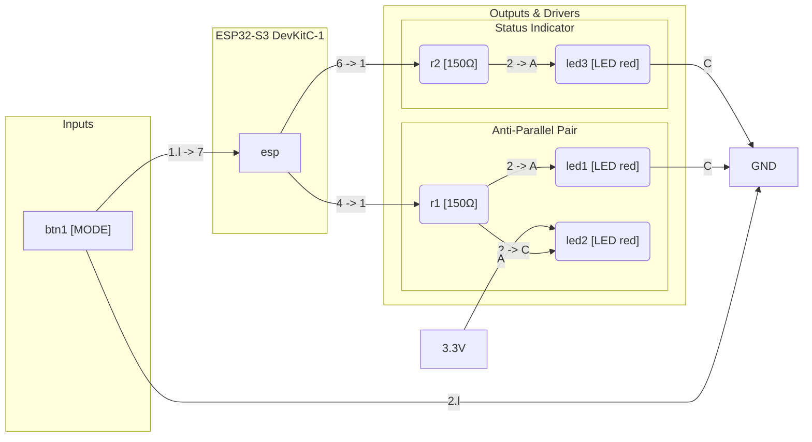

# Mermaid Block Diagram Architecture

Guidelines for generating clean, unidirectional, and readable Mermaid circuit flowcharts (`flowchart LR`) embedded in Markdown reports and READMEs.

## 1. The Cardinal Rule: Strictly Unidirectional Signal Flow

A circuit block diagram visualizes **functional information flow**, not a physical closed current loop.

```
[ Inputs (Sensors/Buttons) ] ---> [ Controller (MCU) ] ---> [ Drivers/Resistors ] ---> [ Actuators/LEDs ] ---> [ GND ]
```

### The Loopback Trap (Why Diagrams Become Tangled)
In an interactive simulator (`diagram.json`), components connect physically back to `esp:GND.1` or `esp:GND.2`.
If an automated script translates those connections directly into Mermaid edges:
```mermaid
flowchart LR
    esp --> led1
    led1 --> esp  %% BAD: loopback arrow cuts across the entire diagram!
```
Mermaid treats `esp` as both the root source and the terminal sink. This forces Mermaid's layout engine to bend return edges backwards around nodes, creating a tangled spiderweb of criss-crossing curved lines.

---

## 2. Power & Ground Abstraction

To ensure clean left-to-right rendering:
1. **Ground Returns**: Never point back into the microcontroller block. Terminate at a local sink node:
   ```mermaid
   led1 -->|Cathode| gnd[GND]
   btn1 -->|pin 2| gnd[GND]
   ```
2. **Power Rails (3.3V / 5V)**: Source from a dedicated power node rather than looping out from the MCU:
   ```mermaid
   pwr["3.3V"] -->|Anode| led2
   ```
3. **Breadboard Jumper Bypassing**: Do not render the breadboard (`bb1`) as a physical node. Resolve intermediate breadboard row nets so components connect to components directly (`r1 --> led1`).

### Sink Branches and Connection Order

A push-pull pin can sink a branch: 3V3 -> resistor -> LED -> GPIO. The physical
current enters the pin, but the block diagram still shows **signal flow** from the
controller to the load. Write that connection controller-first in `diagram.json`:

```json
["esp:4", "led_blue:C", "blue", ["v40", "h-20"]]
```

The generator then emits `esp --> led_blue`. Writing the LED first
(`["led_blue:C", "esp:4"]`) emits `led_blue --> esp` and produces the loopback
arrow this document forbids. Fix the connection order in `diagram.json`; never
hand-edit the generated Mermaid text.

---

## 3. Structural Subgraphs Pattern

Organize circuit elements into functional subgraphs for instant readability:



### Key Visual Properties
* Zero backward edges.
* All signal arrows travel from left to right.
* Ground and Power are clear terminal points.
* Easily browsable in GitHub web rendering without scrolling or zoom confusion.
