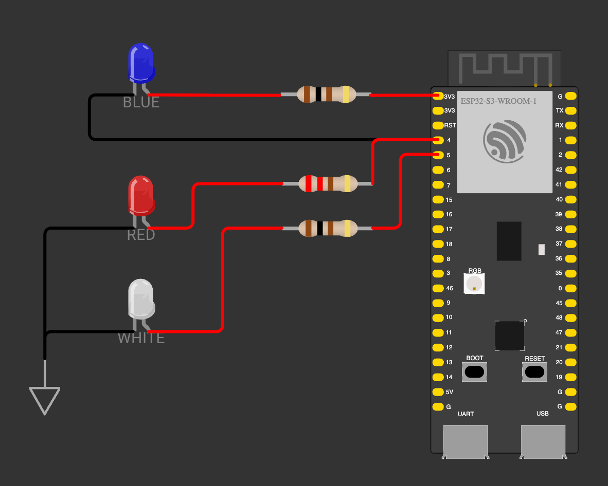

# Police Flasher

Independent PlatformIO homework for `1_3-police-flasher`. An ESP32-S3 drives a
red/blue police beacon pair and a white strobe LED.

**Status:** in-progress

## Behaviour

- GPIO4 drives the red and blue LEDs in push-pull. Output HIGH lights red
  (GPIO to resistor to LED to ground); output LOW lights blue (3.3 V to
  resistor to LED to GPIO); high-impedance input turns both off.
- GPIO5 drives the white third LED active-high through its own resistor.
- The `police_pattern` library owns a framework-free step table: a red double
  flash, a blue double flash, three white strobe pulses, and a pause. The step
  duration doubles on every full cycle, so the cadence alternates between fast
  and slow.
- `src/main.cpp` is the composition root: it maps the resolved pattern step
  onto the port GPIO contract and never blocks longer than one millisecond.

## Layout

| Path | Purpose |
|------|---------|
| `src/main.cpp` | Arduino composition root and GPIO mapping |
| `lib/police_pattern/` | Framework-free pattern state machine |
| `test/test_police_pattern/` | Unity native tests for the pattern |
| `assets/diagram.json` | Wiring source of truth |
| `assets/wiring.png` | Visual Wokwi wiring screenshot |
| `assets/schematic.svg` | Generated IEEE vector schematic |

## Wiring and Schematic

### Visual Breadboard Diagram



### Bill of Materials

| Ref | Component | Value / Spec | Quantity | Connection |
|-----|-----------|--------------|----------|------------|
| `esp` | ESP32-S3-DevKitC-1 | N8 (16 MB flash, 8 MB PSRAM) | 1 | Microcontroller |
| `r_red` | Resistor | 220 Ω, 1/4 W | 1 | GPIO4 ↔ Red LED Anode |
| `led_red` | Red LED | 5 mm THT, Vf ≈ 2.0 V | 1 | `r_red` ↔ GND |
| `r_blue` | Resistor | 100 Ω, 1/4 W | 1 | 3.3V ↔ Blue LED Anode |
| `led_blue` | Blue LED | 5 mm THT, Vf ≈ 2.9 V | 1 | `r_blue` ↔ GPIO4 (Sink) |
| `r_white` | Resistor | 100 Ω, 1/4 W | 1 | GPIO5 ↔ White LED Anode |
| `led_white` | White LED | 5 mm THT, Vf ≈ 3.0 V | 1 | `r_white` ↔ GND |

### Engineering Schematic (IEEE)


## Build and test

```sh
pio run -d homeworks/1_3-police-flasher
pio test -d homeworks/1_3-police-flasher -e native
```

## Documents

- [Assignment paraphrase](task.md)
- [Report](report.md)
- [Wiring source of truth](assets/diagram.json)
- [Visual wiring diagram](assets/wiring.png)
- [Vector schematic](assets/schematic.svg)
