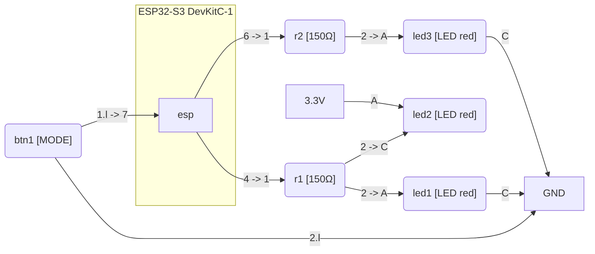

# Police Flasher

This project is the independent PlatformIO homework for `1_3-police-flasher`: an
ESP32-S3 Arduino police flasher whose pattern logic runs on the host in native unit
tests.

**Status:** complete

- [Report](report.md)
- [Assignment paraphrase](task.md)

The project must live at `homeworks/<id>`, two levels below the repository root, so
every relative path — including the shared partition table — resolves.

## Schematic and Wiring

The circuit provides three complementary visualization tiers: an IEEE electrical schematic, an interactive Wokwi breadboard model, and a GitHub Mermaid block diagram.

### Electrical Schematic (IEEE Std)


### Breadboard Layout (Wokwi)

The physical wiring on a half-size solderless breadboard (`wokwi-breadboard-half`), component placement, and orthogonal Manhattan jumper routing are modeled in [`assets/diagram.json`](assets/diagram.json).

### Block Diagram (Mermaid)



## Simulation

`wokwi.toml` points at `.pio/build/esp32s3_arduino/firmware.merged.bin`, so build the
target before running the scenario. `wokwi-cli` 0.28.1 joins the values of
`--diagram-file` and `--scenario` to the positional project directory, not to the shell
working directory. Pass both option values relative to the project directory; passing
repository-root paths makes the CLI join the project path twice and abort before it
opens a connection. From the repository root:

```sh
pio run -d homeworks/1_3-police-flasher
wokwi-cli homeworks/1_3-police-flasher --diagram-file assets/diagram.json --scenario scenario.yaml
```

The equivalent form enters the project first, passes `.` as the positional project
argument, and keeps the same two option values:

```sh
cd homeworks/1_3-police-flasher
pio run
wokwi-cli . --diagram-file assets/diagram.json --scenario scenario.yaml
```

Execution needs `WOKWI_CLI_TOKEN`, and a missing token aborts earlier than path
resolution, so it cannot prove the paths. Run the command with
`WOKWI_CLI_TOKEN=dummy` to prove both paths resolve locally: the run reaches the
WebSocket connection or token stage without a real credential. The only token value
that belongs in this file is `dummy`; never write a real token here.
`wokwi-cli lint --offline homeworks/1_3-police-flasher/assets/diagram.json` validates the
wiring without one.

The scenario exercises complete interactive behavior within ~1.2s of simulation time:
- Boot check: asserts `pattern ready` serial message and confirms GPIO4 drives HIGH during frame 0.
- Short button press: sets `btn1` pressed for 50 ms (debounced), asserting transition to `mode: double_flash`.
- Long button press: sets `btn1` pressed for 650 ms (holding past 600 ms), asserting transition to `speed: fast`.

The commands and evidence are recorded in the report and in
`.planning/phases/07-simulation-spike/07-SPIKE-EVIDENCE.md`, and the tool decision is in
`docs/decisions/0014-simulator-selection.md`.
