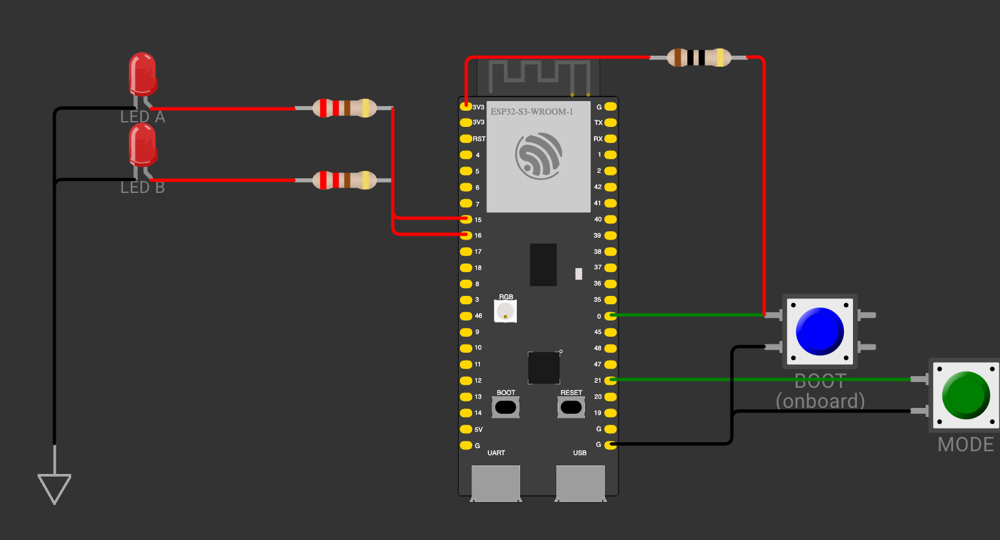
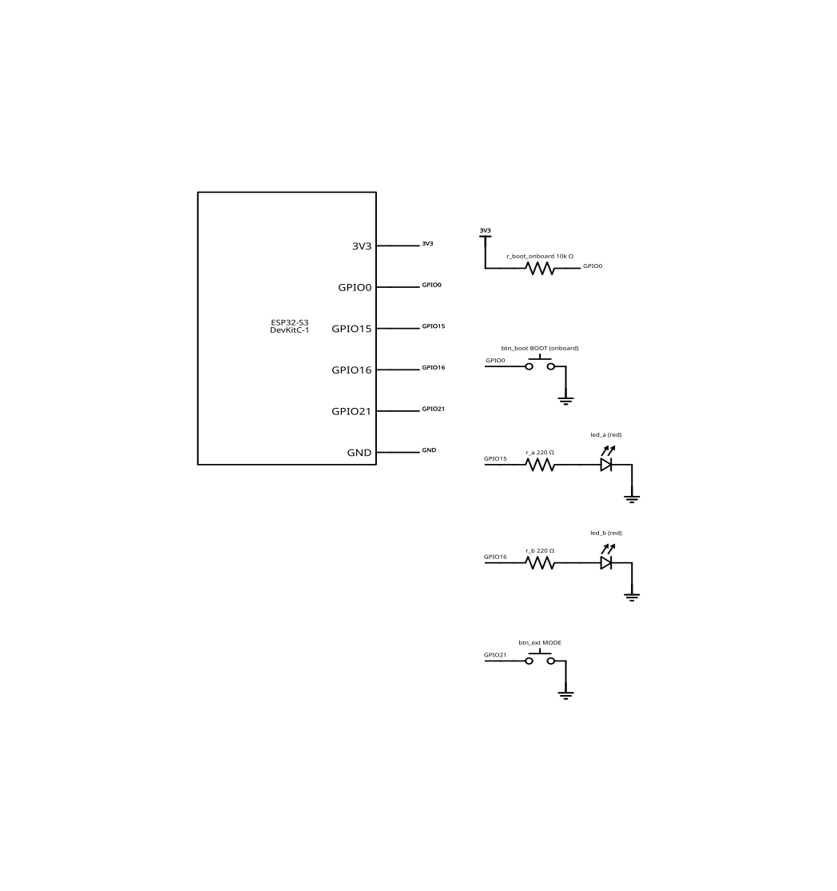

# Dual LED Modes with External and BOOT Buttons

Independent PlatformIO homework for `1_4-dual-led-button-modes`: two red LEDs on
GPIO15 and GPIO16 through 220 ohm series resistors, an external mode button on
GPIO21 configured as `INPUT_PULLUP`, and the onboard BOOT button on GPIO0
configured as `INPUT` because the ESP32-S3-DevKitC-1 provides its external
pull-up.

**Status:** planned. The assignment provenance is still `TODO`, so the metadata
schema keeps the homework at `planned` and the report at `placeholder`.

- [Assignment paraphrase](task.md)
- [Engineering report](report.md)
- [Wiring source of truth](assets/diagram.json) and [vector schematic](assets/schematic.svg)
- [Wokwi configuration](assets/wokwi.toml)

## Behaviour

- Mode 1 (default, selected by the external button): both LEDs together, 200 ms period.
- Mode 2 (selected by BOOT): alternating LEDs, 1000 ms period.
- The selection lives in RAM and resets to mode 1 on every reset.
- Both buttons are debounced for 20 ms; a stable press edge selects the mode.
- If both buttons produce a press edge in the same poll, BOOT wins mode 2.

## Wiring and Schematic

### Visual Breadboard Diagram



### Bill of Materials

| Reference | Component | Value / Model | Connections / Function |
|-----------|-----------|---------------|------------------------|
| `esp` | Microcontroller Board | ESP32-S3-DevKitC-1 | Core controller (USB-C, 3.3 V logic) |
| `led_a` | Red LED | Standard 5 mm Red ($V_f \approx 2.0\text{ V}$) | Mode indicator LED A (GPIO15, active-HIGH source mode) |
| `r_a` | Current-limiting Resistor | $220\ \Omega$, 0.25 W | Limits GPIO15 LED A current to $\approx 5.9\text{ mA}$ |
| `led_b` | Red LED | Standard 5 mm Red ($V_f \approx 2.0\text{ V}$) | Mode indicator LED B (GPIO16, active-HIGH source mode) |
| `r_b` | Current-limiting Resistor | $220\ \Omega$, 0.25 W | Limits GPIO16 LED B current to $\approx 5.9\text{ mA}$ |
| `btn_ext` | Pushbutton (tactile) | Momentary NO | External MODE button (GPIO21, active-LOW with internal pull-up) |
| `btn_boot` | Pushbutton (onboard / sim) | Momentary NO | Onboard BOOT button (GPIO0, active-LOW) |
| `r_boot_onboard` | Pull-up Resistor (sim) | $10\text{ k}\Omega$ | Onboard 3.3 V pull-up equivalent for BOOT |

### IEEE Vector Schematic



## Build and test

```sh
pio run -d homeworks/1_4-dual-led-button-modes
pio test -d homeworks/1_4-dual-led-button-modes -e native
```

## Simulation

`assets/diagram.json` is the only netlist. `assets/wokwi.toml` points the Wokwi
VS Code extension at the PlatformIO build artifacts. The Wokwi board part has no
onboard BOOT button and no external pull-up, so the diagram models both
explicitly and labels them "onboard"; they are simulation equivalents, not extra
hardware. Headless simulation was not run because `WOKWI_CLI_TOKEN` is absent.
