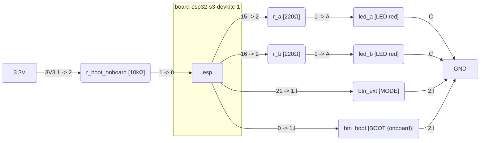

# Dual LED Modes with External and BOOT Buttons

This report documents homework 1.4: two red LEDs on GPIO15 and GPIO16, an
external mode button on GPIO21, and the onboard BOOT button on GPIO0 of an
ESP32-S3-DevKitC-1. The implementation separates the mode-selection and blink
schedule into a framework-free private library, verifies that logic with twelve
native tests, and records the wiring in `assets/diagram.json`. The evidence is
build, native-test, schematic, and offline-lint evidence; no bench measurement
and no completed simulation session exist yet.

## 1. Title and Metadata

| Field | Value |
|-------|-------|
| Homework ID | `1_4-dual-led-button-modes` |
| Title | Dual LED Modes with External and BOOT Buttons |
| Board | esp32-s3-devkitc-1 |
| Framework | arduino |
| Language | C++ |
| PlatformIO Core | 6.2.0 |
| Platform | espressif32@8.0.0 |
| Homework status | planned |
| Report status | placeholder |
| Implementation commit | TODO (pending commit) |
| Wiring | [assets/diagram.json](assets/diagram.json) |

The status pair is deliberate. The assignment provenance in `task.md` is still
the `TODO` sentinel, which the metadata schema permits only while `status` is
`planned`; the report therefore cannot honestly move to `draft` until a real
source, retrieval date, attribution, and licence replace it.

## 2. Objective

The assignment asks the student to configure digital pins as inputs and
outputs, use the internal pull-up, and keep a selected blink mode until the
other button is pressed. This implementation delivers:

- Mode 1, the startup default and the external-button selection: both LEDs
  switch together with a 200 ms period.
- Mode 2, the BOOT-button selection: the LEDs alternate with a 1000 ms period.
- A stable press edge selects a mode; the mode lives in RAM and every reset
  returns to mode 1.
- A 20 ms debounce on both buttons and a deterministic priority when both
  press edges appear in the same poll.
- A target build, a twelve-case native suite, a generated vector schematic, and
  an offline-linted Wokwi netlist.

## 3. Assumptions

| ID | Assumption | Impact if wrong | Validation |
|----|------------|-----------------|------------|
| A-01 | Both buttons are debounced for 20 ms with `common_debounce_update` although the assignment does not mention contact bounce [5]. | A bounce could be counted as several presses; the visible mode would still be selected, but the log and edge detection would be noisier. | `test_debounce_rejects_a_short_glitch` drives a 10 ms glitch and asserts that the mode does not change. |
| A-02 | The phrase "fixed in memory" means a RAM variable, not NVS persistence, because the assignment also states that startup defaults to mode 1. | If NVS were intended, a reset would restore the last mode and contradict the stated startup default. | `test_startup_selects_mode_1_and_lights_both_leds` initialises the state and asserts mode 1. |
| A-03 | The LEDs are red 5 mm parts with Vf 1.85 V min and 2.5 V typ at 20 mA [7]. | A blue or white LED (Vf about 3.0 V) would draw about 1.4 mA and appear dim, although it would remain electrically safe. | `C-01`, `C-02`, and `C-03` bound the current and power for the red-LED range. |
| A-04 | When both buttons produce a stable press edge in one poll, the external button is evaluated first and BOOT second, so BOOT wins mode 2. | A simultaneous press would select mode 1 instead; the pattern would differ, with no electrical risk. | `test_simultaneous_press_selects_mode_2` starts in mode 2, presses both buttons, and asserts that mode 2 remains. |

## 4. Theory

### Pin modes and button polarity

An output pin sources or sinks the LED current. An `INPUT_PULLUP` pin enables
the chip-internal weak pull-up, so a button wired from the pin to ground reads
HIGH when open and LOW when pressed [3]. The ESP32-S3 datasheet gives the
internal pull-up as 45 kOhm typical and the default drive strength as 20 mA for
GPIO0, GPIO15, GPIO16, and GPIO21 [2].

The BOOT button is wired differently by the assignment: GPIO0 is configured as
`INPUT`, because the DevKitC-1 already carries an external 10 kOhm pull-up [1].
That is functionally necessary rather than cosmetic. The Arduino-ESP32 core
builds a `gpio_config_t` with `pull_up_en = GPIO_PULLUP_DISABLE` for `INPUT`,
so the chip-internal pull-up is switched off by `pinMode(0, INPUT)` [6]. The
board pull-up keeps the pin defined when the button is released.

GPIO0 is also a strapping pin. The datasheet lists GPIO0, GPIO3, GPIO45, and
GPIO46 as strapping pins and gives GPIO0 a weak pull-up at reset [1], [2],
[10]. Holding BOOT low while reset is released deliberately enters firmware
download mode; the application firmware only runs when the pin is high at the
reset sampling instant.

### Mode selection

Both buttons are active LOW. The logic observes a stable HIGH-to-LOW edge, not
the held level, so releasing a button never selects a mode. `common_debounce_update`
changes its candidate timestamp on the poll that first sees the new raw level
and confirms the candidate only after at least 20 ms, so the firmware must poll
once at the transition and once after the interval. The state stores the
previous stable level and compares it with the new stable level to detect the
press edge.

The selection is absolute: the external button sets mode 1 and BOOT sets mode 2,
and the mode is kept in RAM until the other button is pressed. A reset clears
the state and `blink_modes_init` selects mode 1. The external button is
evaluated first and BOOT second, which makes a simultaneous edge
deterministic (A-04).

### Non-blocking schedule

The assignment describes `delay(200)` and `delay(1000)`, but a blocking delay
also suspends button sampling for the whole interval. Arduino's
`Blink Without Delay` documents the alternative: keep a timestamp and let the
loop do other work [4]. This implementation uses `common_elapsed_ms` and a
phase timestamp. When the elapsed time exceeds one period, it advances by the
whole number of periods rather than a single edge, so a late poll keeps the
correct parity instead of drifting behind the wall clock.

Mode 1 maps the phase to both LEDs; mode 2 maps the phase to LED A and its
inverse to LED B. The only `delay()` left in the firmware is `delay(1)` in
`loop()`, a scheduler yield that keeps input sampling far finer than the 20 ms
debounce.

### Limitations

- No bench instrument is connected, so the actual LED current, the actual
  period, and the thermal behaviour are not measured.
- The Wokwi board part has no onboard BOOT button and no external GPIO0
  pull-up [9]. The diagram models both explicitly as simulation equivalents,
  labelled "onboard"; this is a simulation fidelity gap, not extra hardware.
- The headless simulation was not run because `WOKWI_CLI_TOKEN` is absent. A
  local VS Code run is configured but has not yet produced a screenshot or VCD
  artifact.
- A short press can still be missed if the loop is blocked for longer than the
  press, but the 1 ms yield makes that window much smaller than the 20 ms
  debounce.
- GPIO0 remains a boot-strapping pin; the firmware cannot remove that hardware
  constraint.

## 5. Hardware and Wiring

The wiring source of truth is [assets/diagram.json](assets/diagram.json); the
generated vector schematic is
[assets/schematic.svg](assets/schematic.svg). The diagram is authored in the
Wokwi format [11] and rendered with the repository generator.

### Bill of Materials

| Ref | Part or value | Quantity | Package | Source or link | Notes |
|-----|---------------|----------|---------|----------------|-------|
| esp | ESP32-S3-DevKitC-1-N8 | 1 | DevKitC-1 | Espressif user guide [1] | 3.3 V logic; onboard BOOT button and 10 kOhm pull-up on GPIO0 |
| led_a | Red 5 mm LED | 1 | 5 mm THT | Kingbright WP7113SRD/E [7] | Vf 1.85 V min and 2.5 V typ at 20 mA |
| led_b | Red 5 mm LED | 1 | 5 mm THT | Kingbright WP7113SRD/E [7] | Vf 1.85 V min and 2.5 V typ at 20 mA |
| r_a | 220 Ohm | 1 | 1/4 W THT | Assignment value | Series resistor for LED A; C-01, C-02, C-03 |
| r_b | 220 Ohm | 1 | 1/4 W THT | Assignment value | Series resistor for LED B; C-01, C-02, C-03 |
| btn_ext | Tactile pushbutton | 1 | 6 mm THT | Generic part | GPIO21 to GND; internal pull-up, active low |
| btn_boot | Onboard BOOT button | 1 | onboard | DevKitC-1 [1] | GPIO0 to GND; Wokwi models it as an external equivalent [9] |
| r_boot_onboard | 10 kOhm | 1 | onboard | DevKitC-1 [1] | GPIO0 pull-up; modelled explicitly in Wokwi because `INPUT` disables the internal pull-up [6] |

### Pin Map

| Signal | Pin | Connects to | Notes |
|--------|-----|-------------|-------|
| LED A drive | GPIO15 | `r_a:2` -> `r_a:1` -> `led_a:A`; `led_a:C` -> `gnd1:GND` | Output, active high; 220 Ohm series |
| LED B drive | GPIO16 | `r_b:2` -> `r_b:1` -> `led_b:A`; `led_b:C` -> `gnd1:GND` | Output, active high; 220 Ohm series |
| External mode button | GPIO21 | `btn_ext:1.l`; `btn_ext:2.l` -> `gnd1:GND` | `INPUT_PULLUP`; active low; 20 ms debounce |
| BOOT mode button | GPIO0 | `btn_boot:1.l`; `btn_boot:2.l` -> `gnd1:GND` | `INPUT`; active low; onboard 10 kOhm pull-up |
| BOOT pull-up rail | 3V3 | `r_boot_onboard:2` -> `r_boot_onboard:1` -> GPIO0 | Onboard 10 kOhm; simulation equivalent in Wokwi |
| Ground return | GND | `gnd1:GND` | LED cathodes and both button returns |
| Serial log | TX/RX | `$serialMonitor` at 115200 baud | `arduino_log_port` output; optional evidence |

### Electrical Calculations

| ID | Quantity | Formula | Units | Input provenance | Result | Uncertainty | Assumption effect |
|----|----------|---------|-------|------------------|--------|-------------|-------------------|
| C-01 | Series resistor selection (CALC-01) | R_min = (Vs - Vf_min) / I_target | Ohm | Vs = 3.3 V from the board rail [1]; Vf_min = 1.85 V at 20 mA [7]; I_target = 10 mA design target | R_min = 145 Ohm; the specified 220 Ohm is above the minimum and therefore sets a lower current | Vf +/-0.1 V gives R_min 135-155 Ohm; resistor tolerance +/-5% | A-03: a red LED; a higher Vf lowers the current |
| C-02 | LED operating current (CALC-02) | I = (Vs - Vf) / R | mA | Vs = 3.3 V [1]; Vf = 1.85-2.5 V [7]; R = 220 Ohm +/-5% | 3.6-6.6 mA | Vf +/-0.1 V and R +/-5% give about +/-0.4 mA at the extremes | A-03: a lower Vf raises the current |
| C-03 | Resistor power dissipation (CALC-03) | P = I^2 * R | mW | I from C-02; R = 220 Ohm | 2.9-9.6 mW | Dominated by the squared current; about +/-1.2 mW | A-03: worst case at Vf_min, still below the 250 mW 1/4 W rating |
| C-04 | Off-state reverse voltage (CALC-04) | Vr = Vs - Vf | V | Not applicable: both LEDs are unipolar and the off LED has 0 V across it; no reverse-bias path exists | Not applicable | Not applicable | Not applicable |
| C-05 | Blink period (CALC-05) | T = configured period; realized T = T + one loop tick | ms | 200 ms and 1000 ms from `lib/blink_modes`; 1 ms loop tick from `src/main.cpp` | 200 ms and 1000 ms nominal; quantization <= 1 ms | 1 ms loop tick | The 1 ms yield keeps input sampling below the 20 ms debounce |
| C-06 | GPIO current margin (CALC-06) | margin = I_max - I; utilization = I / I_max * 100 | mA and % | I_max = 20 mA default drive [2]; I from C-02 | Margin 13.4-16.4 mA; utilization 18-33% | Current from C-02; the 20 mA value is a datasheet limit | A-03: worst case at Vf_min; a lower Vf raises utilization |
| C-07 | Voltage divider (CALC-07) | Vout = Vin * R2 / (R1 + R2) | V | Not applicable: no analog sense input in this design | Not applicable | Not applicable | Not applicable |
| C-08 | Pull-up sizing (CALC-08) | R_max = (Vs - V_ih) / I_leak | Ohm | Vs = 3.3 V; V_ih = 0.75 * 3.3 V = 2.475 V [2]; I_leak = 50 nA [2]; chosen 10 kOhm external and 45 kOhm internal | R_max about 16.5 MOhm; both chosen pull-ups are far below the bound | Datasheet limits; leakage rises with temperature | A-02: GPIO0 relies on the onboard 10 kOhm because `INPUT` disables the internal 45 kOhm [6] |

### Safety Checklist

- **Hazard.** GPIO0 is a strapping pin; holding BOOT low while reset is released enters firmware download mode and the application does not start. Check: release BOOT before reset; the onboard 10 kOhm keeps GPIO0 high in normal operation [1], [10].
- **Hazard.** An LED without a series resistor can draw excessive current and damage the GPIO or the LED. Check: every LED branch has 220 Ohm; C-01, C-02, and C-06 bound the current and the pin margin.
- **Hazard.** A button wired to the 3.3 V rail instead of ground can short the rail when pressed. Check: both buttons return to ground and rely on pull-ups [3].
- **Hazard.** Electrostatic discharge can damage the board while wiring. Check: power down and ground yourself before handling the board.
- **Hazard.** The USB supply and the 3.3 V regulator have a finite current budget. Check: two LEDs at 6.6 mA worst case draw 13.2 mA total, far below the board rail capability; C-03 bounds the resistor power.

## 6. Methodology

The work followed the repository workflow from a clean `hw/1_4-dual-led-button-modes`
branch. The commands and their observed results were:

1. Scaffold: `uv run scripts/new_homework 1_4-dual-led-button-modes --template arduino`
   created the project, and `uv run scripts/check_metadata.py homeworks/1_4-dual-led-button-modes`
   reported `PASS: metadata contract satisfied`.
2. Target build: `pio run -d homeworks/1_4-dual-led-button-modes` finished with
   `SUCCESS` in 9.16 s, using 6.9% of RAM and 4.8% of flash.
3. Editor database: `pio run -d homeworks/1_4-dual-led-button-modes -t compiledb`,
   `uv run scripts/gen_clangd_db.py --generate`, and
   `clangd-wrapper --check=homeworks/1_4-dual-led-button-modes/src/main.cpp`
   reported `All checks completed, 0 errors`.
4. Native suite: `pio test -d homeworks/1_4-dual-led-button-modes -e native`
   ran `test/test_blink_modes` and reported 12 of 12 cases passed in 0.626 s.
5. Diagram: `uv run scripts/gen_schematic.py homeworks/1_4-dual-led-button-modes --all`
   wrote `assets/schematic.svg` and printed the Mermaid block; the `--check`
   run exited 0.
6. Diagram lint: `wokwi-cli lint --offline homeworks/1_4-dual-led-button-modes/assets/diagram.json`
   reported two informational `unsupported-part` notes for the ESP32-S3 board
   and the ground symbol, with no errors.
7. Wokwi configuration: `assets/wokwi.toml` resolves both firmware paths to
   existing files. The local VS Code path is: select the config file
   `homeworks/1_4-dual-led-button-modes/assets/wokwi.toml`, then start the
   simulator. No headless run was executed because `WOKWI_CLI_TOKEN` is absent.
8. Report gate: `uv run scripts/check_report.py` is the machine gate once the
   status pair moves to `in-progress` and `draft`; the current `planned` and
   `placeholder` pair deliberately keeps the document outside that gate.

No bench instrument was connected, so no measurement step was performed. The
expected local simulation sequence is mode 1 at startup (both LEDs together),
BOOT selects mode 2 (alternating LEDs), and the external button returns to mode
1. That sequence is a prediction until a run artifact exists.

## 7. Results

**Native suite.** `pio test -d homeworks/1_4-dual-led-button-modes -e native`
passed all twelve cases in `test/test_blink_modes`: startup mode 1, mode 1
timing, mode 2 timing, external-button return, debounce rejection, mode
persistence, simultaneous-press priority, read-failure safety, late-poll
parity, mode-switch phase reset, null-argument rejection, and default-period
fallback. The result is `PASSED` with 12 of 12 cases.

**Simulation.** Pending. `assets/diagram.json` and `assets/wokwi.toml` are
validated offline, and `wokwi-cli lint --offline` reports no errors, but no
simulation session was run: `WOKWI_CLI_TOKEN` is absent and no local VS Code
screenshot or VCD artifact exists [8]. No value in this report is labelled
`simulated`.

### Measurement Ledger

| ID | Quantity | Value | Label | Instrument | Method | Uncertainty | Implementation commit |
|----|----------|-------|-------|------------|--------|-------------|-----------------------|
| L-01 | LED A/B operating current | 3.6-6.6 mA | calculated | none | C-02 with Vs from [1], Vf from [7], and R = 220 Ohm | Vf +/-0.1 V and R +/-5%; about +/-0.4 mA | TODO (pending commit) |
| L-02 | LED forward voltage | Vf 1.85 V min and 2.5 V typ at 20 mA | datasheet | Kingbright WP7113SRD/E [7] | Datasheet table | +/-0.1 V | TODO (pending commit) |
| L-03 | ESP32-S3 GPIO drive | 20 mA default drive; IOH 40 mA; IOL 28 mA | datasheet | Espressif ESP32-S3 datasheet [2] | Datasheet table | Datasheet limit | TODO (pending commit) |
| L-04 | Mode 1 period | 200 ms nominal; quantization <= 1 ms | calculated | none | C-05; `test_mode_1_toggles_both_leds_every_200_ms` checks the 199/200/200 ms boundaries | 1 ms loop tick | TODO (pending commit) |
| L-05 | Mode 2 period | 1000 ms nominal; quantization <= 1 ms | calculated | none | C-05; `test_boot_selects_mode_2_and_alternates_every_1000_ms` checks the 999/1000 ms boundaries | 1 ms loop tick | TODO (pending commit) |
| L-06 | Wokwi behavior | not measured: no headless token and no local run artifact | not measured | none | `wokwi-cli lint --offline` only; no simulation session | Not applicable | TODO (pending commit) |
| L-07 | Bench LED current | not measured: no bench instrument connected | not measured | none | No bench measurement performed | Not applicable | TODO (pending commit) |

### Traceability Matrix

| ID | Claim or requirement | Design artifact | Verification method | Evidence | Status |
|----|----------------------|-----------------|---------------------|----------|--------|
| T-01 | REPORT-01: ten-section academic report | `report.md` | `check_report.py` once the status pair moves to draft; content follows `.agents/standards/report.md` | Sections 1-10 and the Decision Appendix | manual |
| T-02 | REPORT-02: bill of materials | `report.md` section 5; `assets/diagram.json` | Every BOM `Ref` is a diagram part id | BOM table | manual |
| T-03 | REPORT-03: pin map and diagram source of truth | `report.md` section 5; `assets/diagram.json` | `gen_schematic.py --check`; `wokwi-cli lint --offline` | `assets/schematic.svg`; lint exited 0 | verified |
| T-04 | REPORT-04: electrical calculations | `report.md` section 5 | CALC-01 through CALC-08 rows; hand arithmetic | C-01 through C-08 | manual |
| T-05 | REPORT-05: electrical safety checklist | `report.md` section 5 | Review of each hazard and its check | Safety checklist | manual |
| T-06 | REPORT-06: measurement ledger labels | `report.md` section 7 | Closed label vocabulary and provenance depth | L-01 through L-07 | manual |
| T-07 | REPORT-07: traceability matrix | `report.md` section 7 | This table; `check_report.py` | T-01 through T-14 | manual |
| T-08 | REPORT-08: honest status, limitations, next steps | `report.md` sections 4, 8, 9 | Review of the status and limitation claims | Status paragraph; Next Steps | manual |
| T-09 | Mode 1: both LEDs toggle every 200 ms | `lib/blink_modes/src/blink_modes.c` | `pio test -e native` | `test_mode_1_toggles_both_leds_every_200_ms` passed | verified |
| T-10 | Mode 2: LEDs alternate every 1000 ms | `lib/blink_modes/src/blink_modes.c` | `pio test -e native` | `test_boot_selects_mode_2_and_alternates_every_1000_ms` passed | verified |
| T-11 | Debounce, mode latch, simultaneous priority, read-failure safety | `lib/blink_modes/src/blink_modes.c` | `pio test -e native` | Four dedicated cases passed | verified |
| T-12 | Target firmware builds for ESP32-S3 | `src/main.cpp`; `platformio.ini` | `pio run -d homeworks/1_4-dual-led-button-modes` | SUCCESS in 9.16 s | verified |
| T-13 | Local Wokwi simulation path | `assets/diagram.json`; `assets/wokwi.toml` | `wokwi-cli lint --offline`; VS Code steps | Lint reports two informational notes; no run artifact | pending |
| T-14 | Full report contract (REPORT-01 through REPORT-08) | `report.md` | `check_report.py` after the status pair moves to draft | Blocked by the `TODO` provenance sentinel | pending |

## 8. Analysis

The evidence supports the buildability of the target firmware, the correctness
of the mode schedule and button logic at the native level, and the electrical
safety of the 220 Ohm series choice for the red-LED range. Twelve native cases
cover the startup mode, both periods, both selection paths, debounce, mode
latch, simultaneous priority, read-failure fallback, late-poll parity, phase
reset, null arguments, and default fallback. The target build and the clangd
check confirm that the Arduino composition root compiles against the shared
ports and the private library.

The evidence does not support a claim about the physical LED current, the
realized period on hardware, thermal behaviour, or the actual bounce profile of
the fitted buttons. Those remain `not measured` because no bench instrument was
connected. The Wokwi path is configured and linted, but a lint result is not a
run: it proves the netlist and part pin names are valid, not that the LEDs
behave as designed in simulation. The report therefore makes no `simulated`
claim.

Industry note: non-blocking timing and input debounce are standard practice in
embedded control loops because a blocking delay couples input latency to output
period, and a mechanical contact is not a clean logic edge [4], [5]. The same
reasoning explains why a strapping pin such as GPIO0 is treated as a boot-time
constraint rather than a general-purpose input: the hardware samples it before
the application can intervene [2], [10].

## 9. Conclusions

The implementation meets the assignment's functional requirements at the
source and native-test level: mode 1 is the startup default and the
external-button selection, mode 2 is the BOOT selection, the selection is held
until the other button is pressed, and both buttons are debounced. The target
build is green, the native suite is green, the schematic is generated from the
single netlist, and the netlist passes the offline linter. The main open items
are provenance, a simulation artifact, and bench measurement.

Status: the implementation, target build, native suite, schematic generation,
and offline diagram lint are complete and verified on the working tree. The
report remains declared `placeholder` and the homework remains `planned`
because `task.md` provenance is still `TODO`; a real `source_url`, `retrieved`,
`attribution`, and `license` must replace it before the metadata status can
move to `in-progress` and the report to `draft`. The Wokwi simulation is
`pending`: the local VS Code path is configured, but no headless token is
present and no screenshot or VCD artifact exists. Owning phase: repository
Phase 10 (report and artifact contract) for the status transition, and the
homework delivery branch for the simulation artifact and bench evidence.

### Next Steps

1. Supply the real assignment provenance in `task.md` and `homework.yaml`, then
   flip the homework status to `in-progress` and the report to `draft`; the
   owner is the author, and the condition that closes the item is a clean
   `check_metadata.py` and `check_report.py` run.
2. Run the local Wokwi simulator in VS Code, capture a screenshot as
   `assets/simulation.png`, and record the observed sequence; the owner is the
   author, and the condition is a saved artifact plus a `simulation.status:
   verified` update.
3. Measure the LED current and the two periods on the bench with a multimeter
   or logic analyzer; the owner is the author, and the condition is a
   `measured` ledger row with an instrument, method, and uncertainty.
4. Commit the implementation and replace the `TODO (pending commit)` cells in
   section 1 and the ledger with the commit hash; the owner is the author, and
   the condition is a commit whose tree matches the tested working tree.

## 10. References

[1] Espressif Systems, "ESP32-S3-DevKitC-1 v1.1 User Guide," [Online]. Available: https://docs.espressif.com/projects/esp-dev-kits/en/latest/esp32s3/esp32-s3-devkitc-1/user_guide_v1.1.html. Accessed: 2026-10-28.

[2] Espressif Systems, "ESP32-S3 Series Datasheet," [Online]. Available: https://documentation.espressif.com/esp32-s3_datasheet_en.pdf. Accessed: 2026-10-28.

[3] Arduino, "Digital Input Pull-Up Resistor," [Online]. Available: https://docs.arduino.cc/tutorials/generic/digital-input-pullup/. Accessed: 2026-10-28.

[4] Arduino, "Blink Without Delay," [Online]. Available: https://docs.arduino.cc/built-in-examples/digital/BlinkWithoutDelay/. Accessed: 2026-10-28.

[5] Arduino, "Debounce on a Pushbutton," [Online]. Available: https://docs.arduino.cc/built-in-examples/digital/Debounce/. Accessed: 2026-10-28.

[6] Espressif Systems, "Arduino-ESP32 core, esp32-hal-gpio.c," [Online]. Available: https://github.com/espressif/arduino-esp32/blob/master/cores/esp32/esp32-hal-gpio.c. Accessed: 2026-10-28.

[7] Kingbright, "WP7113SRD/E Super Bright Red LED Datasheet," [Online]. Available: https://www.kingbrightusa.com/images/catalog/SPEC/wp7113srd-e.pdf. Accessed: 2026-10-28.

[8] Wokwi, "ESP32 Simulation," [Online]. Available: https://docs.wokwi.com/guides/esp32. Accessed: 2026-10-28.

[9] Wokwi, "ESP32-S3-DevKitC-1 board definition," [Online]. Available: https://github.com/wokwi/wokwi-boards/blob/master/boards/esp32-s3-devkitc-1/board.json. Accessed: 2026-10-28.

[10] Random Nerd Tutorials, "ESP32-S3 DevKitC Pinout Reference Guide," [Online]. Available: https://randomnerdtutorials.com/esp32-s3-devkitc-pinout-guide/. Accessed: 2026-10-28.

[11] Wokwi, "diagram.json File Format," [Online]. Available: https://docs.wokwi.com/diagram-format. Accessed: 2026-10-28.

## Decision Appendix

| ID | Requirement | Authority | Conflict or risk | Recommendation | Decision |
|----|-------------|-----------|------------------|----------------|----------|
| D-01 | Mode 1 uses `delay(200)` and mode 2 uses `delay(1000)`; a single press selects the other mode | Arduino Blink Without Delay [4]; Arduino Debounce [5] | A blocking delay suspends input sampling, so a short press during the 1 s interval is lost and the mode may appear unresponsive | Use a non-blocking `common_elapsed_ms` state machine with the same 200 ms and 1000 ms periods and poll every loop | Accepted: non-blocking state machine (C-01 in the state record); the report's A-01 and the Theory section state the deviation |
| D-02 | BOOT is an onboard button on GPIO0 with an external pull-up | DevKitC-1 user guide [1]; Wokwi board definition [9]; Arduino-ESP32 core [6] | The Wokwi board part has no BOOT button and no external pull-up, and `pinMode(0, INPUT)` disables the internal 45 kOhm pull-up | Model the onboard button and 10 kOhm pull-up as explicit external equivalents labelled "onboard" | Accepted: simulation equivalents only, not extra hardware; A-03 and section 4 Limitations record the fidelity gap |
| D-03 | 220 Ohm series resistors; LED colour and forward voltage unspecified | Kingbright WP7113SRD/E [7]; ESP32-S3 datasheet [2] | The forward-voltage spread changes the current, but every value in the red-LED range stays below the LED and GPIO limits | Use red 5 mm LEDs and keep the specified 220 Ohm resistors | Accepted: A-03; C-01, C-02, C-03, and C-06 bound the result |
| D-04 | "Fixed in memory" with mode 1 as the startup default | Assignment text | RAM retention and NVS persistence are both plausible readings of "memory" | Keep the mode in RAM; every reset starts in mode 1; no NVS write | Accepted: A-02; the startup default makes the RAM reading observable |
| D-05 | Button contact bounce is not mentioned | Arduino Debounce [5] | A mechanical contact can produce several transitions per press | Debounce both buttons for 20 ms with `common_debounce_update` | Accepted: A-01; covered by a native test |
| D-06 | Simultaneous press of both buttons is not specified | Repository determinism rule | An implicit evaluation race would make the selected mode depend on poll order | Evaluate the external button first and BOOT second, so BOOT wins mode 2 | Accepted: A-04; covered by a native test |
