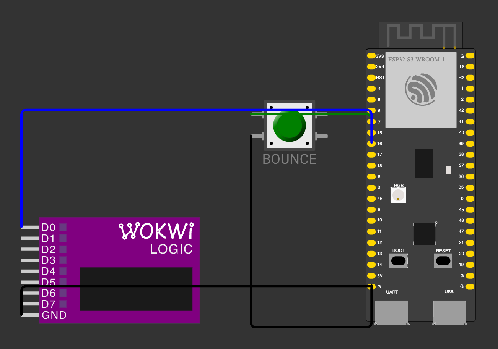
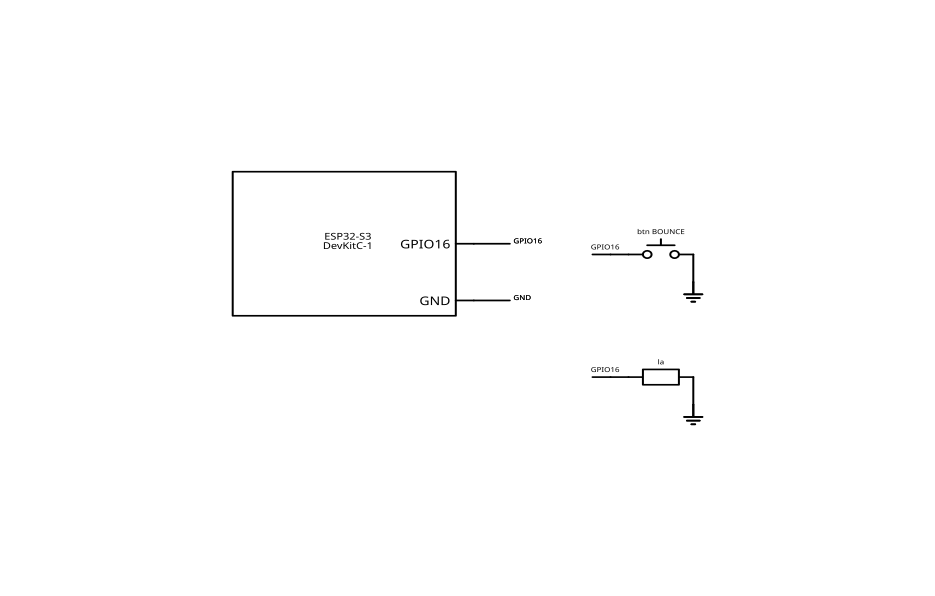

# Button Contact Bounce Analysis with a Logic Analyzer and a Microcontroller

Independent PlatformIO homework for `1_5-button-bounce`. It measures contact bounce on a
pull-up pushbutton, records every edge on GPIO 16, and compares the firmware count with a
logic analyzer capture of the same node.

**Status:** complete. The firmware, the wiring, and the ten-press bench capture are done, and
the [report](report.md) records the measured results.

- [Assignment paraphrase](task.md)
- [Report](report.md)
- [Wiring source of truth](assets/diagram.json)
- [IEEE vector schematic](assets/schematic.svg)

## Wiring

### Visual Breadboard Diagram



### Bill of Materials

| Reference | Component | Value / Model | Connections / Function |
|-----------|-----------|---------------|------------------------|
| `esp` | Microcontroller Board | ESP32-S3-DevKitC-1 | Core controller (USB-C, 3.3 V logic) |
| `btn` | Pushbutton (tactile) | Momentary NO | BOUNCE test button on GPIO 16 (active-LOW with internal pull-up) |
| `la` | Logic Analyzer (instrument / sim) | 8-channel 24 MS/s | Channel D0 connected to GPIO 16, GND to board GND |

### Connections

| Signal | ESP32-S3 pin | Connects to |
|--------|--------------|-------------|
| Button contact A | GPIO 16 (J3-9) | One side of the momentary pushbutton |
| Button contact B | GND | The other side of the pushbutton |
| Analyzer channel 1 | GPIO 16 (J3-9) | Logic analyzer `D0` |
| Analyzer ground | GND | Logic analyzer `GND` |

GPIO 16 is configured as `INPUT_PULLUP`; the internal pull-up is typically 45 kOhm. The
button therefore reads HIGH when released and LOW when pressed. The analyzer and the board
must share a ground, and the analyzer input must tolerate 3.3 V logic.

### IEEE Vector Schematic



## Measurements

The bench evidence is the raw firmware log
[`serial.log`](assets/measurements/serial.log) and the Saleae Logic 8-channel export
[`digital.csv`](assets/measurements/digital.csv). The analyzer ran at 24 MS/s over a 12.364 s
capture and recorded 74 transitions (37 falling, 37 rising). The firmware `TOTAL` line
reports 65 edges (35 falling-level, 30 rising-level), a difference of -9 edges (-12.2%).

Five bounce events were measured: one press-phase event of 0.25 us and four release-phase
events of 363.167, 3780.25, 305.5 and 441.333 us. The mean is 978.1 us, or 1222.6 us for the
release-phase events alone. The largest HIGH gap inside a bounce cluster is 160.625 us, so
the minimum sufficient debounce is 1 ms; the 20 ms online window is about 124x that measured
gap.

## Build

```sh
pio run -d homeworks/1_5-button-bounce
```

The single environment is `esp32s3_arduino`. The 256-edge capture and the burst analysis both
live in `src/main.cpp`; the homework has no host test suite.

## Flash and capture

```sh
pio run -d homeworks/1_5-button-bounce -t upload --upload-port <PORT>
pio device monitor --port <PORT> --baud 115200
```

The serial port is never selected implicitly. Replace `<PORT>` with the port printed by
`pio device list`.

## Serial protocol

The firmware prints a fixed header, then one block per burst:

```text
BOUNCE_LOGGER 1
BUTTON_PIN=16 QUIET_GAP_MS=250 DEBOUNCE_MS=20
READY
BURST edges=7 falling=4 rising=3 duration_us=1200 max_high_us=150 min_stable_ms=1 settled=LOW overflow=0
E 0 100 L
E 1 250 H
...
TOTAL falling=4 rising=3 debounced=1
READY
```

A burst is dumped after 250 ms without a new edge, so serial traffic never interleaves with
the bounce it describes. A press ends `settled=LOW`; a release ends `settled=HIGH`. The
`TOTAL` line carries the running raw counts and the debounced press count.

## Measurement procedure

1. Wire the button between GPIO 16 and GND, and the analyzer channel to GPIO 16 with a
   common ground.
2. Flash the firmware and open the serial monitor at 115200 baud.
3. Wait for `READY`, then press the button ten times with different speed and force.
4. Save the serial log and the analyzer capture of the same interval.
5. For each press, pair the `BURST` lines with the analyzer clusters formed by a 10 ms gap
   over the `E` transitions, and compare the edge totals.
6. The ledger in [`report.md`](report.md) already records the captured values. Repeat the
   procedure and update both evidence files if the button or the wiring changes.

## Layout

- `src/main.cpp` — the complete firmware: pin and `CHANGE` interrupt, the 256-edge capture
  with interrupts briefly disabled while the loop copies it, the burst analysis, the serial
  protocol, and the online debounce path.
- `assets/diagram.json` — the Wokwi wiring model; `assets/schematic.svg` is generated from it.
- `assets/measurements/serial.log` — the raw firmware log from the ten-press capture.
- `assets/measurements/digital.csv` — the 24 MS/s logic-analyzer export of the same interval.
